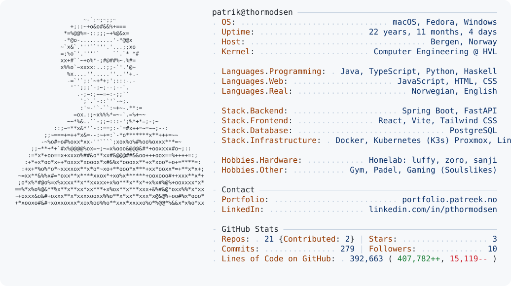
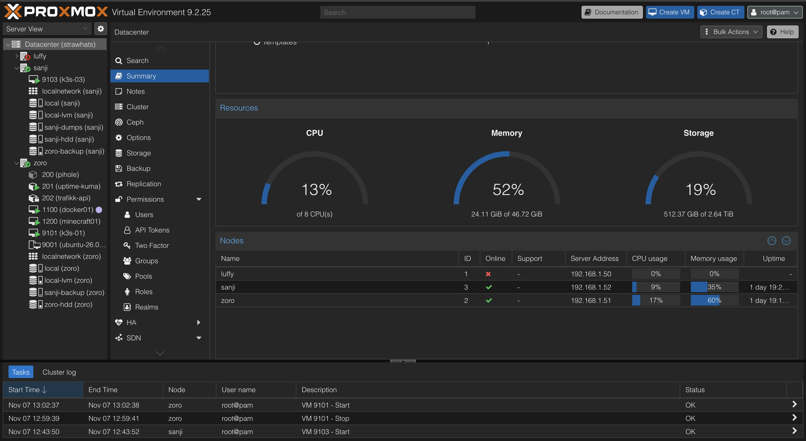
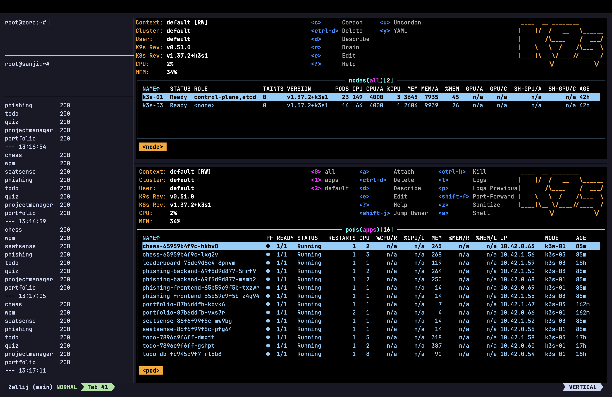

<a href="https://portfolio.patreek.no">
  <picture>
    <source media="(prefers-color-scheme: dark)" srcset="dark_mode.svg" />
    
  </picture>
</a>

<h3 align="center">About me</h3>

I'm a Computer Engineering student at HVL in Bergen, Norway. I enjoy programming and spend a lot of my free time working on personal projects.
I mainly work with Java, Spring Boot, React and TypeScript, and enjoy both developing applications and figuring out how to deploy and run them.
Lately, I've also been getting into self-hosting and running my own homelab with Proxmox, Docker and Kubernetes (k3s).
Outside of programming, I enjoy going to the gym, playing padel and spending time with friends. I'm also into gaming, especially Soulslike games.

<a href="https://portfolio.patreek.no"><b>Portfolio</b></a>

---

<h3 align="center">Tech Stack</h3>

**Languages**

<picture>
  <source media="(prefers-color-scheme: light)" srcset="https://skillicons.dev/icons?i=java%2Cts%2Cjs%2Cpy%2Chaskell&theme=light" />
  
</picture>

 

**Frameworks & Databases**

<picture>
  <source media="(prefers-color-scheme: light)" srcset="https://skillicons.dev/icons?i=spring%2Creact%2Cfastapi%2Cpostgres%2Ctailwind&theme=light" />
  
</picture>

 

**Infrastructure & Tools**

  <picture>
    <source media="(prefers-color-scheme: light)" srcset="https://skillicons.dev/icons?i=linux%2Cdocker%2Ckubernetes&theme=light" />
    
  </picture>
  
  <picture>
    <source media="(prefers-color-scheme: light)" srcset="https://skillicons.dev/icons?i=cloudflare%2Cgithubactions%2Cgit&theme=light" />
    
  </picture>

---

<h3 align="center">Featured Projects</h3>

| Project | Description | Links |
| :--- | :--- | :--- |
| **SeatSense** | IoT-based seat occupancy monitoring using ESP32 sensors and React. | [Demo](https://seatsense.patreek.no) · [Code](https://github.com/pthormodsen/SeatSense) |
| **QuizApp** | Full-stack study application built with Spring Boot and React. | [Demo](https://quiz.patreek.no) · [Code](https://github.com/pthormodsen/QuizApp) |
| **Phishing URL Detector** | Machine learning URL classifier with FastAPI and a React frontend. | [Demo](https://phishing.patreek.no) · [Code](https://github.com/pthormodsen/PhishingURL) |
| **Chess** | Java chess application with Stockfish integration. | [Demo](https://chess.patreek.no) · [Code](https://github.com/pthormodsen/Chess) |
| **Portfolio** | My personal site and blog, with a typing test and shared leaderboard. | [Site](https://portfolio.patreek.no) · [Code](https://github.com/pthormodsen/portfolio) |

All demos are self-hosted on my own k3s cluster.

---

<h3 align="center">Homelab</h3>

I run a small homelab on **Proxmox VE** with three machines: **zoro**, **sanji** and **luffy**. Zoro and sanji are always on, luffy is my loudest PC and only gets turned on for game servers.

Most of my projects run on a **k3s** cluster across zoro and sanji, with two replicas of each app spread over both machines, so one of them can go down without the sites going offline. Traffic comes in through **Cloudflare Tunnels**, images are built with **GitHub Actions** and stored on **GHCR**, and I use **Tailscale** for remote access and **Uptime Kuma** for monitoring.

The databases still only run on one machine, so next up is adding a small third node and setting up replicated Postgres, so those can survive a machine going down too.

  
    
  

<a href="https://portfolio.patreek.no/blog/moving-my-homelab-to-k3s">How I set it up →</a>

---

<h3 align="center">GitHub Activity</h3>

<picture>
  <source media="(prefers-color-scheme: light)" srcset="https://raw.githubusercontent.com/pthormodsen/pthormodsen/output/github-snake.svg" />
  
</picture>

