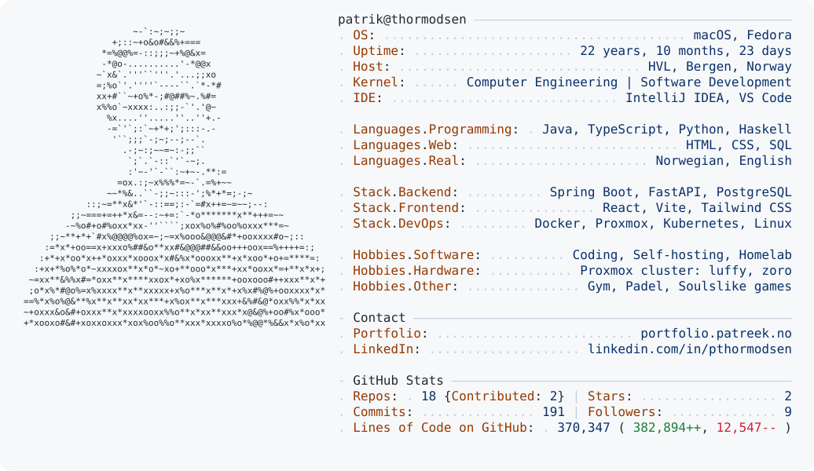

<a href="https://portfolio.patreek.no">
  <picture>
    <source media="(prefers-color-scheme: dark)" srcset="dark_mode.svg" />
    
  </picture>
</a>

### About me

I'm a Computer Engineering student at HVL in Bergen, Norway, and I spend a lot of my free time coding and working on personal projects.

I mostly work with Java, Spring Boot, React and TypeScript, and I like being involved in everything from building the application to getting it up and running.

I've also gotten pretty into self-hosting over the past year. What started as experimenting with a few servers has turned into a homelab with Proxmox, Docker and Kubernetes.

When I'm not sitting in front of a computer, I enjoy going to the gym, playing padel and hanging out with friends. I'm also into gaming, although that usually means spending even more time in front of a screen.

[**Portfolio**](https://portfolio.patreek.no)

---

### Tech Stack

**Languages**

 

<picture>
  <source media="(prefers-color-scheme: light)" srcset="https://skillicons.dev/icons?i=java%2Cts%2Cjs%2Cpy%2Ccpp%2Chaskell&theme=light" />
  
</picture>

  

**Frameworks & Databases**

 

<picture>
  <source media="(prefers-color-scheme: light)" srcset="https://skillicons.dev/icons?i=spring%2Creact%2Cfastapi%2Cpostgres%2Ctailwind&theme=light" />
  
</picture>

  

**Infrastructure & Tools**

 

  <picture>
    <source media="(prefers-color-scheme: light)" srcset="https://skillicons.dev/icons?i=linux%2Cdocker%2Ckubernetes&theme=light" />
    
  </picture>
  
  <picture>
    <source media="(prefers-color-scheme: light)" srcset="https://skillicons.dev/icons?i=cloudflare%2Cgit&theme=light" />
    
  </picture>

### Featured Projects

| Project | Description | Links |
| :--- | :--- | :--- |
| **SeatSense** | IoT-based seat occupancy monitoring using ESP32 sensors and React. | [Demo](https://seatsense.patreek.no) |
| **QuizApp** | Full-stack study application built with Spring Boot and React. | [Demo](https://quiz.patreek.no) · [Code](https://github.com/pthormodsen/QuizApp) |
| **Phishing URL Detector** | Machine learning URL classifier with FastAPI and a React frontend. | [Demo](https://phishing.patreek.no) · [Code](https://github.com/pthormodsen/PhishingURL) |
| **Chess** | Java chess application with Stockfish integration. | [Demo](https://chess.patreek.no) · [Code](https://github.com/pthormodsen/Chess) |

### Homelab

I run a small homelab with three nodes named **luffy**, **zoro**, and **sanji**, where I experiment with infrastructure and self-host several of my own applications.

It runs on **Proxmox VE**, with a **k3s** cluster (control plane and worker nodes), **Docker**, and my own network services: **Cloudflare Tunnels**, **Tailscale**, **Pi-hole**, and **Uptime Kuma** for monitoring.

### GitHub Activity

<picture>
  <source media="(prefers-color-scheme: light)" srcset="https://raw.githubusercontent.com/pthormodsen/pthormodsen/output/github-snake.svg" />
  
</picture>

